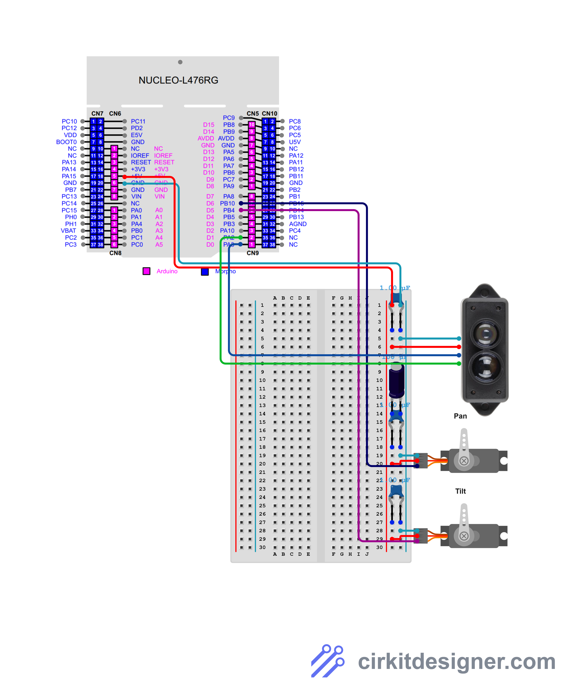
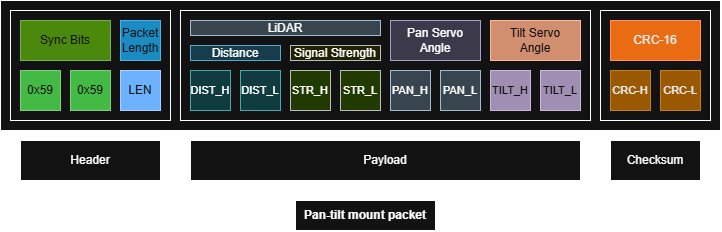

# Environment Mapper Project

- [Assembly](#assembly)
- [How it works](#how-it-works)

---

**The ability to scan an environment in 3D can take your project to the next dimension.. Literally.**

Unfortunately, prebuilt LiDAR scanning systems are very cost prohibitive for hobbyists and small teams. That's why we 
designed a **3D LiDAR environment mapping system** based on an STM32, TFMini LiDAR, and 2 SG90 mini servos.
This project is designed to be highly portable. Just design a power network as outlined in the `shield` folder, attach the 
noted hardware (see _Assembly_), upload the STM32 project in `firmware` to your own STM32, and viola!
You now have a functional 3D environment mapper.

To make this project more interactive, a desktop app is also included in this repo, designed to be a companion to the 
hardware, translating the points over UART and displaying them in a point cloud right on your computer.
Utilizing the lightweight OpenGL C++ framework, this app can achieve a 100Hz refresh rate and a rotatable model using GLM.

## Assembly

### Components

To build the environment mapper, you will need the following equipment:

- STM32 Nucleo L476RG Development Board (or equivalent)
- 2 SG90 mini servos
- 1 TFMini v2 LiDAR
- 1 pan/tilt mount (this [adafruit mount](https://www.adafruit.com/product/1967#:~:text=Technical%20Details.%20Dimensions%3A%20*%20Base%3A%2037mm%20x,36mm%20%2F%201.5%22x%201.4%22%20*%20Weight%3A%2037g) is a good option)

For the power network and connections, you can either get the equipment below or fabricate a shield using the files in the `shield` directory:

- 1 breadboard
- 5V 3A power supply, and breadboard connector
- jumper cables

### Optional Components

To improve the power distribution to the servos and LiDAR, we included bulk and local decoupling capacitors.
If you want to include these capacitors:

- 3 1uF _ceramic_ capacitors (faster transient response)
- 1 100uF _electrolytic_ capacitor (bigger bulk storage)

### Putting it all together

To assemble the Environment Mapper pan-tilt mount and lidar circuit, reference the schematic below.

<!-- markdownlint-disable MD033 -->
<figure>
  
  <figcaption>Figure 1: Power and UART connections between the MCU and sensor circuitry.</figcaption>
</figure>
<!-- markdownlint-enable MD033 -->

<!-- For quick reference, the connections (excluding power and GND) are as follows:

- **LiDAR TX** >  -->

Note that the capacitors are optional. However, it is recommended that an external 5V supply is used to power the 5V rail,
rather than the STM32's rail, due to the high current demands of the 2 SG90 servos during startup. This can be provided by
connecting a suitable power supply (for breadboarding
[this supply](https://www.amazon.com/dp/B0CWFG5LBM?lv=shuf&hvlocphy=106466&linkCode=df0&psc=1&hvnetw=o&hvadid=80195839596071&hvbmt=be&hvlocint=&hvdev=c&hvocijid=17449357714194124364-B0CWFG5LBM-&hvqmt=e&hvexpln=0&tag=bingshoppinga-20&hvtargid=pla-4583795320013176&channelId=69&ref_=asc_df_B0CWFG5LBM&plpRedirect=mhFallback)
is a good option) to the E5V port on the STM32, or simply using it as the 5V rail.

## How it works

### Hardware

Now that we've covered the assembly of the environment, a short description of its functionality would be in order.
To begin with the hardware, we used 2 SG90 servos and a Benewake TFMini V2 LiDAR sensor to provide the sensor circuit.
The servos are controlled with PWM, while the LiDAR is controlled using a UART connection.
For more information on the controls of either component, please take a look at
[the code](https://github.com/steelscape02/environment_mapper/tree/main/STM32Project/EnviornmentMapper)
in the repo.

<!-- Include Hardware Block Diagram -->

### Software

As the pan-tilt mount rotates during operation, the PWM data sent to the servos and the UART data received
from the LiDAR are assembled on the STM32 board into a UART packet, the structure of which is shown in **Figure 2**,
for display.

<!-- markdownlint-disable MD033 -->
<figure>
  
  <figcaption>Figure 2: Environment Mapper UART Packet Structure</figcaption>
</figure>
<!-- markdownlint-enable MD033 -->

This 13-byte packet contains all of the information needed to display the points and provide some feedback on reading
accuracy. Please refer to the table below for what each byte does:

| Byte      |   Type          |                      Description                                                      |
|-----------|-----------------|---------------------------------------------------------------------------------------|
| 0x59 (x2) | Sync Bytes      | Helps the program determine the start of a new packet.                                |
| LEN       | Length          | Tells the program how long of a packet to expect                                      |
| DIST_H+L  | Distance        | 2-byte distance recorded in LiDAR, in cm                                              |
| STR_H+L   | Signal Strength | Signal strength in LiDAR, helping to determine reflectivity of the detected object    |
| PAN_H+L   | Pan Angle       | Pan angle, recorded from the PWM signals sent to the pan servo                        |
| TILT_H+L  | Tilt Angle      | Tilt angle, recorded from PWM signals sent to the tilt servo                          |
| CRC_H+L   | CRC-16 Checksum | CRC checksum for the payload. Provides excellent protection against packet corruption |

Once the desktop program has received a packet over UART, it translates the received point into a polar coordinate system,
using an `(elevation, azimuth, distance)` system. These points are loaded into a LIFO queue, which is then read on a different thread by the graphics utility, which updates the points in near-realtime.

## Citations

If you use this project or Open3D, please cite:

```bibtex
@article{Zhou2018,
  author = {Qian-Yi Zhou and Jaesik Park and Vladlen Koltun},
  title = {{Open3D}: {A} Modern Library for {3D} Data Processing},
  journal = {arXiv:1801.09847},
  year = {2018},
}
```
